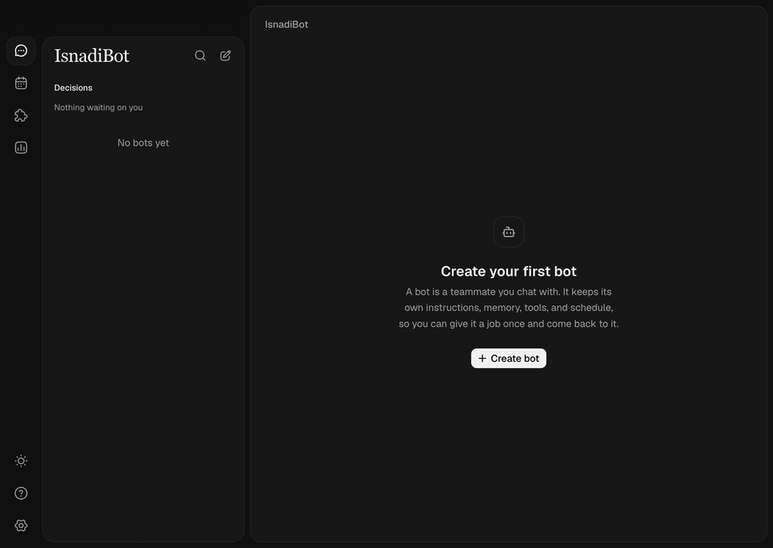

<div dir="rtl">

<p align="center">
  
</p>

<h1 align="center">IsnadiBot</h1>

<p align="center"><strong>Grok Bot مفتوح المصدر.</strong></p>
<p align="center">
  زملاء عمل بالذكاء الاصطناعي، لكل منهم اسم، يعملون على <em>جهازك</em>، باشتراكاتك <em>أنت</em>، وبياناتك تبقى <em>عندك</em>.
</p>
<p align="center"><em>بوتات بذاكرة · محادثات جماعية · حاسوب خاص بكل بوت · تيليجرام وسلاك وواتساب وغيرها · سطح المكتب والويب والجوال</em></p>
<p align="center"><sub>بُني المشروع على مشروع مرخّص بـ MIT من <a href="https://github.com/opencoredev">OpenCore</a>، الذي انطلق بدوره من <a href="https://t3.codes">T3 Code</a>.</sub></p>

<p align="center">
  <a href="./README.md">English</a> ·
  <strong>العربية</strong>
</p>

<p align="center">
  <a href="https://github.com/mohammadchehab/isnadibot/actions/workflows/ci.yml?query=branch%3Amain"></a>
  <a href="LICENSE"></a>
  <a href="https://github.com/mohammadchehab/isnadibot/stargazers"></a>
  
  
  
  <a href="ROADMAP.md"></a>
</p>

<p align="center">
  
  <br>
  <sub>وظّف فريقًا، أعطِ القائد مهمة، وشاهده يوزّع العمل. ردود Claude حقيقية، بسرعة مضاعفة. <a href=".github/assets/fleet-demo.mp4">شاهد الفيديو</a>.</sub>
</p>

---

> [!NOTE]
> زملاء العمل المستضافون بالذكاء الاصطناعي رائعون، إلى أن تنتبه إلى مكان وجودهم: على حاسوب شخص آخر،
> يشغّلون نماذج شخص آخر، ويحتفظون بملفاتك وبيانات دخولك. **IsnadiBot هو الفكرة نفسها، لكن مفتوح المصدر.**
> بوتاتك تعمل في بيئة تملكها أنت (حاسوبك، أو خادمك، أو بيئة معزولة تختارها)، وتعمل عبر اشتراك Claude أو
> ChatGPT أو Grok أو Kimi الذي تدفع له أصلًا. لا يوجد حساب IsnadiBot ولا سحابة IsnadiBot.
>
> بدأ IsnadiBot نسخةً متفرعة من مشروع مرخّص بـ MIT من [OpenCore](https://github.com/opencoredev) ويحتفظ بتاريخه
> الكامل. راجع قسم «شكر وتقدير» في الأسفل.

<p align="center">
  
</p>

---

## ✨ أبرز المزايا

- 🤖 **بوتات لها اسم وذاكرة.** لكل بوت تعليماته ومحركه وأدواته، وملاحظات يحملها إلى المحادثات القادمة.
  يمكنك قراءة كل ما يتذكره وتعديله.
- 👥 **محادثات جماعية تتعاون فعلًا.** ضع عدة بوتات في محادثة واحدة. قائد المجموعة يجيب افتراضيًا، واكتب
  `@` واسم البوت لتمنحه الكلمة.
- 🖥️ **حاسوب خاص بكل بوت.** امنح البوت سطح مكتب معزولًا فيه متصفح. شاهد شاشته مباشرة، وتولَّ التحكم
  لتسجيل الدخول أو حل تحقق، ثم أعد إليه التحكم.
- 📲 **متاح حيث تتواجد أصلًا.** اربط البوت بتيليجرام أو سلاك أو ديسكورد أو واتساب أو iMessage. تصل الرسائل
  إلى محادثة البوت المعتادة، بالأدوات والصلاحيات نفسها.
- 🔑 **استخدم اشتراكك أنت.** يعمل Claude وChatGPT (Codex) وGrok وKimi For Coding وOpenCode عبر بيئة
  التشغيل المدمجة. امزج بينها كما تشاء: بوت يعمل بـ Claude يمكنه توليد الصور عبر ChatGPT.
- 🔐 **محلي أولًا، فعلًا.** المحادثات والبوتات والأسرار والسجلات تبقى على جهازك. الوصول عن بُعد يمر عبر
  شبكتك المحلية أو SSH أو Tailscale، ولا شيء يمر عبر خدمة مستضافة.

---

## 🆚 IsnadiBot مقابل زملاء العمل المستضافين

|                         | **IsnadiBot**                                   | **مستضاف (مثل Grok Bot)** |
| ----------------------- | ----------------------------------------------- | ------------------------- |
| الشيفرة المصدرية        | ✅ مفتوحة المصدر، رخصة MIT                      | ❌ مغلقة                  |
| أين تعمل بوتاتك         | جهازك، أو خادمك، أو بيئة معزولة تختارها         | سحابة المزوّد             |
| النماذج                 | Claude وChatGPT وGrok وKimi وOpenCode، بأي مزيج | نماذج المزوّد فقط         |
| ملفاتك ومحادثاتك ودخولك | تبقى في بيئتك                                   | مخزنة لدى المزوّد         |
| حساب مطلوب              | لا يوجد                                         | حساب لدى المزوّد          |
| التفريع والتوسيع        | ✅ إضافات وخوادم MCP أو الشيفرة نفسها           | ❌                        |

---

## 🛠️ المزايا بالتفصيل

### 1. البوتات والذاكرة

- **إعداد موجَّه.** اربط اشتراكًا، وقل في جملة بماذا تريد المساعدة، فيقترح البوت خطة قصيرة لنقطة البداية.
  ← [البوتات](docs/user/bots.md)
- **نوعان من الذاكرة.** ذاكرة المحادثة تتابع الحوار الحالي، والملاحظات طويلة المدى تحمل ما تعلّمه البوت عنك
  وعن عمله ومجموعاته. ← [الذاكرة](docs/user/memory.md)
- **أوضاع صلاحيات لكل محادثة.** حدّد الإجراءات التي يمكن للبوت تنفيذها قبل أن يسألك، من المراجعة التلقائية
  حتى الاستقلال الكامل. ← [أوضاع الصلاحيات](docs/user/permission-modes.md)

### 2. المحادثات الجماعية

- **فريق في محادثة واحدة.** عدة بوتات، ومحادثة واحدة، وقائد يجيب افتراضيًا.
- **توجيه بالإشارة `@`.** اكتب `@` واسم البوت لتسأله هو بدلًا من القائد. ← [المحادثات](docs/user/chats.md)
- **مراقبة الصمت.** إذا توقف المزوّد عن الرد 90 ثانية، تخبرك المحادثة وتضيف عنصرًا في صندوق الوارد بدل
  الانتظار بلا نهاية. ← [مراقبة الصمت](docs/user/silence-watchdog.md)

### 3. البيئات المعزولة والتحكم بالحاسوب

- **اختر مكان العمل.** مساحات العمل المحلية لا تحتاج إعدادًا، أو اربط E2B أو Daytona أو Vercel Sandbox أو
  Upstash Box أو Tenki أو Railway أو Ascii Box. ← [البيئات المعزولة](docs/user/sandboxes.md)
- **شاهد سطح مكتب البوت وتحكّم به.** البوت في بيئة Daytona يحصل على سطح مكتب بمتصفح يمكنك مشاهدته مباشرة
  وتولي التحكم فيه. ← [الحاسوب](docs/user/computer.md)

### 4. القنوات والصوت والصور

- **قنوات المراسلة.** امنح بوتًا واحدًا خطًا على تيليجرام أو سلاك أو ديسكورد أو واتساب أو iMessage. على سلاك
  وديسكورد يضع تفاعلًا يوضح أنه يعمل، أو ينتظرك، أو انتهى. ← [القنوات](docs/user/channels.md)
- **مكالمات صوتية.** اتصل ببوت من محادثته في تطبيق الويب أو سطح المكتب: محادثة فورية عبر اشتراك ChatGPT أو
  واجهة OpenAI، أو تفريغ نصي ← رد ← نطق. ← [الصوت](docs/user/voice.md)
- **توليد الصور.** تنشئ البوتات صورًا عبر اشتراك ChatGPT أو Grok الذي ربطته، أيًا كان النموذج الذي تحادثك
  به. ← [توليد الصور](docs/user/image-generation.md)

### 5. الإضافات والأدوات

- **دليل منتقى لإضافات MCP.** تصفّح وصفِّ وافحص ناشر كل إضافة وطريقة مصادقتها ومكان تشغيلها قبل تثبيتها.
  ← [الإضافات](docs/user/plugins.md)

### 6. أينما كنت

- **سطح المكتب والويب والآيفون.** كل التطبيقات تتصل بالبيئة نفسها عبر اتصال WebSocket واحد موثَّق.
- **وصول عن بُعد بلا وسيط.** عبر الشبكة المحلية أو SSH أو Tailscale، من المتصفح أو من هاتفك.
  ← [الوصول عن بُعد](docs/user/remote-access.md)
- **الاستهلاك بنظرة واحدة.** حدود الخطط ونشاط النماذج الأخير عبر كل اشتراكاتك. ← [الاستهلاك](docs/user/usage.md)

---

## 🚀 البدء السريع

### تنزيل التطبيق

نزّل أحدث إصدار من
[github.com/mohammadchehab/isnadibot/releases/latest](https://github.com/mohammadchehab/isnadibot/releases/latest):

- macOS (Apple Silicon): ملف `IsnadiBot-<الإصدار>-arm64.dmg`. التطبيق غير موقَّع بعد، فافتحه مرة واحدة ثم
  انتقل إلى **System Settings → Privacy & Security → Open Anyway**، أو نفّذ
  `xattr -dr com.apple.quarantine /Applications/IsnadiBot.app`.
- Windows (x64): ملف `IsnadiBot-<الإصدار>-x64.exe`. التطبيق غير موقَّع بعد، فاختر في شاشة SmartScreen
  **More info** ثم **Run anyway**.
- Linux (x64): ملف `IsnadiBot-<الإصدار>-x64.AppImage`. نفّذ `chmod +x` على الملف ثم شغّله.

لتشغيل IsnadiBot على خادم بدلاً من ذلك، استخدم `install-remote.sh` (macOS وLinux) أو
`install-remote.ps1` (Windows)، وكلاهما مرفق مع الإصدار. راجع
[الوصول عن بُعد](docs/user/remote-access.md).

### البناء من المصدر

تحتاج Node.js بالإصدار `^24.13.1` و [Vite+](https://vite.plus):

</div>

```bash
git clone https://github.com/mohammadchehab/isnadibot.git
cd isnadibot
curl -fsSL https://vite.plus | bash
vp i
vp run dev
```

<div dir="rtl">

### 🍎 تطبيق macOS (Apple Silicon)

ثبّت Rust، ثم:

</div>

```bash
pnpm dist:desktop:dmg:arm64
```

<div dir="rtl">

تُكتب صورة القرص في المجلد `release/`.

### 📱 تطبيق iOS

تطبيق IsnadiBot للآيفون والآيباد واجهة لبيئتك. بوتاتك تستمر في العمل على حاسوبك أو خادمك، والهاتف يتيح لك
محادثتها ومتابعة عملها وإدارة الإعدادات من أي مكان. التطبيق غير متاح على App Store بعد.

تحتاج جهاز Mac عليه Xcode وحساب مطور لدى Apple (التطبيق يستخدم وحدات أصلية، لذا لا يعمل Expo Go). من
المجلد `apps/mobile`:

</div>

```bash
vp run dev:client   # start Metro
vp run ios:dev      # build and run the dev client, installed as "IsnadiBot Dev"
vp run ios:release  # or build a self-contained release app, installed as "IsnadiBot"
```

<div dir="rtl">

<details>
<summary>حساب Apple المجاني، وربط هاتفك</summary>

مع حساب Apple مجاني (Personal Team)، اضبط `T3CODE_IOS_PERSONAL_TEAM=1` ومعرّف حزمة تملكه في
`T3CODE_IOS_PERSONAL_TEAM_BUNDLE_ID`. هذا البناء لا يتضمن الأدوات المصغّرة، وامتداد المشاركة، والإشعارات،
وتسجيل الدخول عبر Apple.

لربط التطبيق، شغّل `isnadi pair` على الجهاز الذي يعمل عليه IsnadiBot وامسح رمز QR الذي يظهر. الربط عبر
الشبكة المحلية أو Tailscale يعمل بالطريقة نفسها؛ راجع [الوصول عن بُعد](docs/user/remote-access.md) و
[دليل تطبيق الجوال](apps/mobile/README.md).

</details>

### 📂 أين تُحفظ بياناتك

المحادثات والبوتات والإعدادات والأسرار والسجلات تبقى على جهازك في `~/.isnadi`. يُنقل مجلد البيانات القديم إليه عند أول تشغيل
لتنتقل بياناتك كما هي.

---

## 🧱 البنية

IsnadiBot مستودع pnpm متعدد الحزم. خادم البيئة يقوم بالعمل، وكل التطبيقات تتصل به عبر اتصال WebSocket
الموثَّق نفسه.

</div>

```
  Desktop (Electron) ─┐
  Web (React/Vite)  ──┼──► Environment server ──► Claude · ChatGPT · Grok · Kimi · OpenCode
  iOS (Expo)        ──┘    bots · groups · memory     sandboxes · MCP plugins · channels
```

<div dir="rtl">

جدول المكوّنات الكامل موجود في [النسخة الإنجليزية](./README.md#-architecture).

---

## 🙏 شكر وتقدير

IsnadiBot نسخة متفرعة من مشروع مرخّص بـ MIT من [OpenCore](https://github.com/opencoredev)، وهو بدوره نسخة متفرعة من
[T3 Code](https://t3.codes). شكرًا لمشرفي OpenCore وT3 Code والمساهمين فيهما، فهم من بنوا معظم هذا العمل.

IsnadiBot غير مرتبط بـ OpenCore أو T3 Tools أو ping.gg أو xAI أو Anthropic أو OpenAI أو
Moonshot AI. ‏Grok وGrok Bot علامتان تجاريتان لشركة xAI، وذُكرتا هنا للمقارنة فقط.

## 📄 الرخصة

[MIT](./LICENSE). أُبقي إشعار حقوق النشر الأصلي كما تشترط الرخصة. شروط الأطراف الثالثة مذكورة في
[THIRD_PARTY_NOTICES.md](./THIRD_PARTY_NOTICES.md).

</div>
